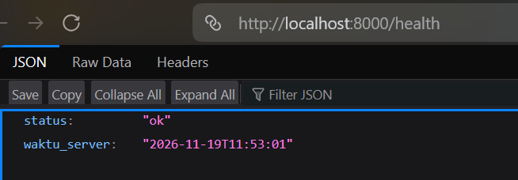
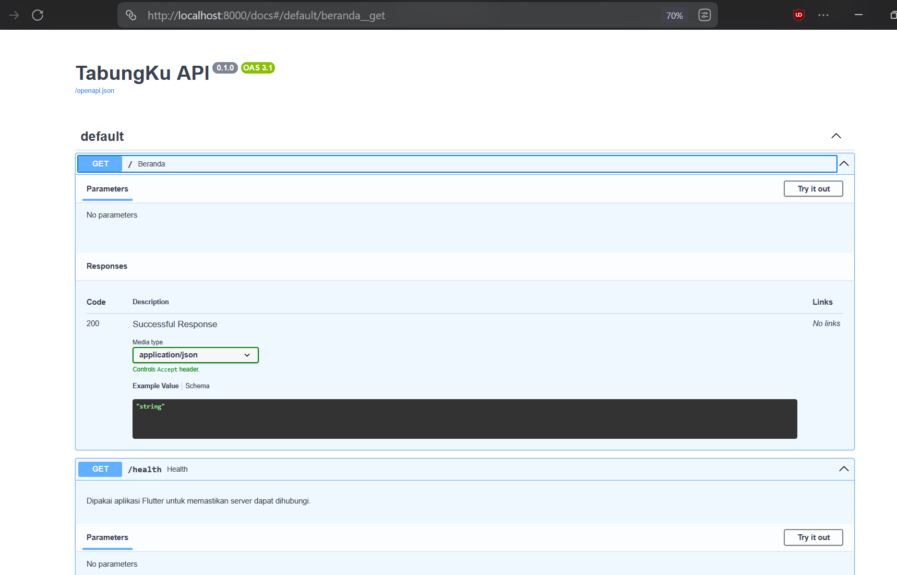
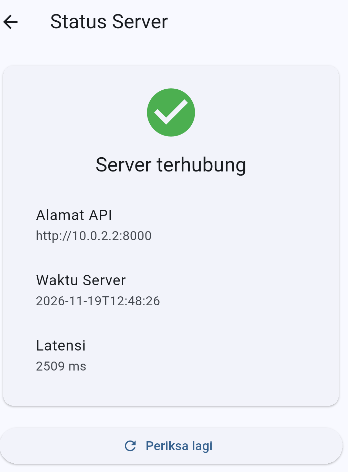
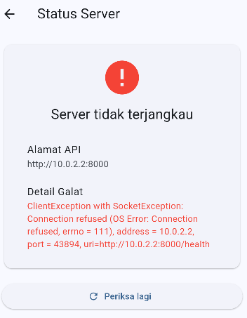
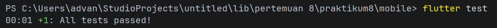
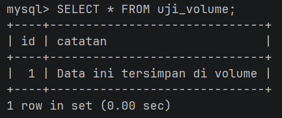
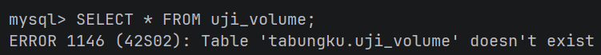

# Praktikum Flutter Lanjutan - Pertemuan 8
**Topik:** Docker Compose dan Kerangka Backend TabungKu Cloud

**Nama :** David Yehezkiel
#
**NIM :** 20240801013

## Deskripsi Proyek

Pada pertemuan ini, aplikasi **TabungKu** mulai bertransformasi dari penyimpanan lokal (SQLite) menuju arsitektur berbasis *cloud* (**TabungKu Cloud**). Seluruh layanan *server* dijalankan secara terpadu menggunakan **Docker Compose** yang mencakup layanan basis data **MySQL 8.4** dan *backend* REST API menggunakan **FastAPI**, serta dihubungkan dengan aplikasi mobile **Flutter** untuk memantau status koneksi server.

---

## Struktur Direktori

```text
pertemuan 8/
├── docs/
│   ├── health.png
│   ├── swagger.png
│   ├── flutter_test.png
│   ├── status_sehat.png
│   ├── status_error.png
│   ├── volume_ada.png
│   └── volume_hilang.png
├── praktikum8/
│   ├── backend/
│   │   ├── app/
│   │   │   ├── __init__.py
│   │   │   ├── config.py
│   │   │   ├── database.py
│   │   │   └── main.py
│   │   ├── .dockerignore
│   │   ├── Dockerfile
│   │   └── requirements.txt
│   ├── mobile/
│   ├── .env.example
│   ├── .gitignore
│   └── docker-compose.yml
├── latihan mandiri/
└── tugas/
```

---

## Ringkasan Pengerjaan

### 1. Docker Compose & Backend FastAPI (`praktikum8`)

- **Containerization:** Membuat `Dockerfile` berbasis `python:3.12-slim` dengan optimasi *layer caching* pada instalasi `requirements.txt`.
- **Orkestrasi Layanan:** Mengonfigurasi `docker-compose.yml` untuk menjalankan layanan `mysql` (port `3307:3306`) dan `api` (port `8000:8000`) menggunakan kredensial dari berkas `.env` serta memastikan urutan nyala layanan melalui `healthcheck` dan `depends_on: condition: service_healthy`.
- **Endpoint Dasar:** Membuat *endpoint* `GET /` dan `GET /health` pada FastAPI beserta dokumentasi otomatis di `/docs` (Swagger UI).

### 2. Integrasi Aplikasi Mobile Flutter (`praktikum8/mobile`)

- **Konfigurasi Jaringan:** Menambahkan izin `INTERNET` dan `android:usesCleartextTraffic="true"` pada `AndroidManifest.xml`, serta mengatur alamat server dinamis menggunakan `--dart-define=API_URL` (`http://10.0.2.2:8000` untuk emulator Android).
- **Halaman Status Server:** Membuat layanan `cekServer()` untuk mengukur latensi dan status koneksi ke `/health`, menampilkannya pada `StatusServerPage`, serta membuat *unit test* menggunakan `MockClient`.

### 3. Latihan Mandiri (`latihan mandiri`)

- **Endpoint `/info`:** Menambahkan *endpoint* `GET /info` yang mengembalikan nama aplikasi, versi, dan zona waktu server.
- **Custom Port:** Mengubah *port mapping* API pada host laptop menjadi `9000:8000` dan menyesuaikan konfigurasi pada Flutter.
- **Uji Ketahanan Volume:** Menguji penyimpanan persisten pada *named volume* `mysql_data` menggunakan perintah `docker compose down` (data tetap tersimpan) dibandingkan dengan `docker compose down -v` (volume dan tabel terhapus).
- **Perbandingan Image:** Membandingkan ukuran *image* berbasis `python:3.12-slim` yang jauh lebih ringan dibandingkan *image* penuh `python:3.12`.

### 4. Tugas Pertemuan 8 (`tugas`)

- **Layanan Adminer:** Menambahkan *container* `adminer:5` pada port `8081` untuk mengelola basis data MySQL melalui *browser*.
- **Pengecekan Database `/health`:** Memperbarui *endpoint* `GET /health` agar mengeksekusi kueri `SELECT VERSION()` dan mengembalikan HTTP status `503` saat *database* tidak dapat dihubungi.
- **Status Terpisah & Simpan URL:** Menampilkan status API dan Database secara terpisah di Flutter, menyediakan dialog pengaturan alamat API dengan validasi URL (`shared_preferences`), serta melengkapi *unit test* untuk tiga skenario (`200`, `503`, dan galat kode lainnya).

---

## Cara Menjalankan

### A. Menjalankan Backend & Database (Docker)

1. Masuk ke folder proyek (`praktikum8`, `latihan mandiri`, atau `tugas`), lalu salin konfigurasi environment:

   ```bash
   cp .env.example .env
   ```

2. Bangun *image* dan jalankan seluruh layanan di latar belakang:

   ```bash
   docker compose up -d --build
   ```

3. Periksa status layanan hingga MySQL berstatus `healthy`:

   ```bash
   docker compose ps
   ```

### B. Menjalankan Aplikasi Flutter & Pengujian

1. Masuk ke direktori `mobile/` dan unduh seluruh paket dependensi:

   ```bash
   cd mobile
   flutter pub get
   ```

2. Jalankan *unit test*:

   ```bash
   flutter test
   ```

3. Jalankan aplikasi pada emulator Android:

   ```bash
   flutter run
   ```

---

## Dokumentasi Hasil Pengujian

### 1. Endpoint Health Check & Swagger UI (`/docs`)

Pengujian *endpoint* `GET /health` melalui *browser* mengembalikan status `ok` beserta waktu server saat ini, dan dokumentasi API interaktif berhasil diakses melalui `/docs`.

|                            Hasil Endpoint `GET /health`                            |               Dokumentasi Interaktif `/docs` (Swagger UI)               |
|:----------------------------------------------------------------------------------:|:-----------------------------------------------------------------------:|
|  |  |

### 2. Aplikasi Flutter (Status Server & Unit Test)

Pengujian otomatis `health_service_test.dart` menggunakan `MockClient` lulus tanpa galat, dan halaman **Status Server** pada aplikasi Flutter mampu mendeteksi kondisi server saat aktif maupun saat dihentikan (`docker compose stop api`).

| Status Server (Sehat) | Server Tidak Terjangkau | Hasil Unit Test (`flutter test`) |
|:---:|:---:|:---:|
|  |  |  |

### 3. Uji Ketahanan Data pada Volume Docker (Latihan Mandiri)

Tabel `uji_volume` tetap tersimpan aman setelah perintah `docker compose down`, namun ikut terhapus permanen saat menggunakan flag `-v` (`docker compose down -v`).

| Data Tersimpan Setelah `down` | Tabel Terhapus Setelah `down -v` |
|:---:|:---:|
|  |  |
